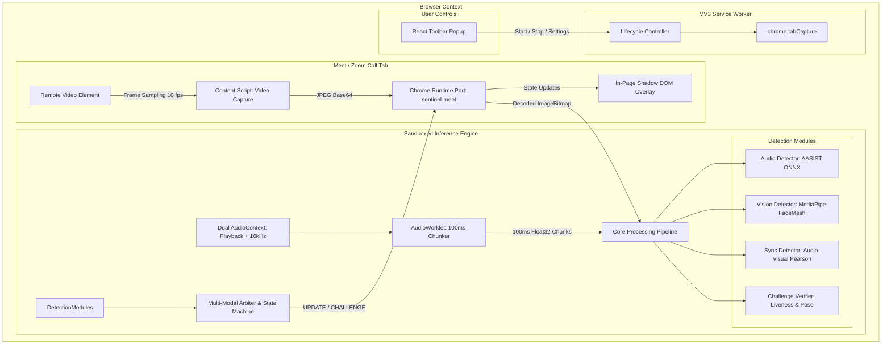

# Sentinel: System Architecture & Technical Design

## 1. Executive Summary

**Sentinel** is an enterprise-grade, on-device anti-scam protection system packaged as a Chrome Extension (Manifest V3). It actively monitors live video conferences on **Google Meet** and **Zoom Web**, detecting synthetic deepfake speech, facial manipulations, and avatar replay attacks in real time without sending any audio, video, or telemetry off the user's workstation.

---

## 2. High-Level System Architecture

---

## 3. Core Subsystems

### 3.1 Audio Ingestion & Dual Routing
- **Constraint**: Google Chrome mutes a tab when capturing its audio stream via `chrome.tabCapture.getMediaStreamId()`.
- **Solution**: The offscreen document initializes **two distinct `AudioContext` instances** on the captured `MediaStream`:
  1. **Playback Context** (Default System Sample Rate): Directly connected to `AudioContext.destination` to ensure the user continues to hear call participants with zero latency or audible artifacts.
  2. **Analysis Context** (Fixed 16 kHz): Feeds an `AudioWorkletNode` ("chunker") that downmixes incoming audio to mono and buffers exact 1600-sample (100 ms) `Float32Array` chunks.

### 3.2 Video Sampling & Transport
- **Remote Video Heuristic**: Content scripts continuously query playing `<video>` elements, discarding mirrored self-view tiles (`transform: matrix(-1, ...)` or `scaleX(-1)`), and selecting the primary speaker tile based on rendered surface area.
- **Serialization**: Remote video frames are drawn to an `OffscreenCanvas`, downscaled to a maximum width of 480 px, compressed to JPEG (`quality: 0.7`, ~15–25 KB), and streamed across `chrome.runtime.Port` to the offscreen worker.
- **Drop Policy**: The pipeline enforces a single-frame in-flight policy, dropping stale frames if vision inference is actively processing, preventing message backlog and UI jitter.

### 3.3 Deepfake Detection Modules

| Package | Model / Technique | Runtime Backend | Output |
|---|---|---|---|
| `@sentinel/audio-detector` | AASIST (Audio Anti-Spoofing Integrated Spectro-Temporal Graph Attention) | ONNX Runtime Web (WASM) | `scoreFake` [0, 1], `confidence` [0, 1] |
| `@sentinel/vision-detector` | MediaPipe FaceLandmarker (468 3D landmarks, mouth aperture, 3-axis head pose) | MediaPipe Vision (WASM) | `mouthAperture`, `headPose`, `landmarkQuality` |
| `@sentinel/sync-detector` | Audio-Visual Lip-Sync (Pearson correlation between RMS audio energy & lip aperture) | Pure TypeScript | Correlation coefficient $r$, `scoreFake` [0, 1] |
| `@sentinel/challenge-verifier` | Interactive 3D head yaw sweeps, hand-to-face occlusion, boundary artifact detection | Geometric Analysis | `passed` \| `failed` \| `pending`, `artifactScore` |

### 3.4 Multi-Modal Arbiter & State Machine

The **Arbiter** (`@sentinel/arbiter`) fuses multi-modal signals using a dynamic weighted average:

$$\text{FusedScore} = \frac{w_A \cdot c_A \cdot s_A + w_V \cdot c_V \cdot s_V}{w_A \cdot c_A + w_V \cdot c_V}$$

Where $w_i$ are module weights, $c_i$ are signal confidences, and $s_i$ are individual fake scores.
- **Exponential Moving Average (EMA)**: Mitigates short-term noise ($\tau = 4000\text{ ms}$).
- **Hysteresis**: Enforces an exit threshold buffer ($\Delta = 0.10$) to prevent state oscillation.
- **States**:
  - `CLEAR`: Nominal metrics, no anomalies detected.
  - `SUSPICIOUS`: Sustained score $> 0.50$ for $\ge 3000\text{ ms}$.
  - `CHALLENGE`: Triggers active liveness challenges (e.g. head turns) to provoke visual generation artifacts.
  - `ALERT`: Critical deepfake confirmation; triggers in-page warning banner and system notification.

### 3.5 Shadow DOM In-Page Overlay
- Injected into the meeting tab inside a closed **Shadow DOM** (`#sentinel-extension-overlay-root`), guaranteeing total CSS isolation from Google Meet or Zoom parent styles.
- Positioned in the upper-right corner; collapsible, accessible, and non-obstructive to native call controls.
