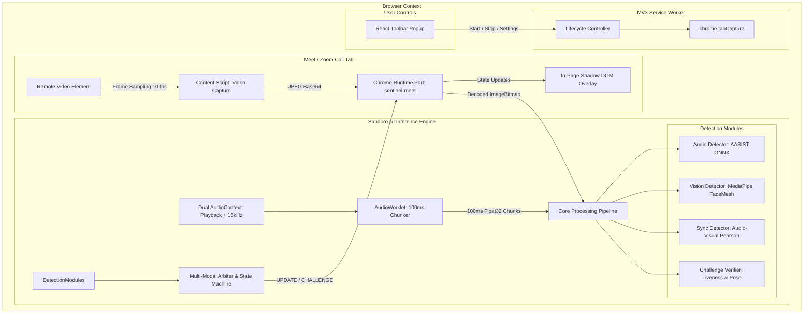

# Sentinel: System Architecture & Technical Design

## 1. Executive Summary

**Sentinel** is a student research prototype packaged as a Chrome Extension (Manifest V3). It has experimental Meet and Zoom Web capture paths and combines audio anti-spoof scores, facial motion measurements, audio/visual synchronization, and challenge heuristics. These signals are not a validated deepfake classifier. No project-owned labeled call dataset is available, and live-call accuracy and latency have not been measured. Runtime CSP restricts extension-page connections to the extension's own origin; see the privacy section below for the evidence boundary.

---

## 2. High-Level System Architecture

---

## 3. Core Subsystems

### 3.1 Audio Ingestion & Dual Routing
- **Constraint**: Google Chrome mutes a tab when capturing its audio stream via `chrome.tabCapture.getMediaStreamId()`.
- **Solution**: The offscreen document initializes **two distinct `AudioContext` instances** on the captured `MediaStream`:
  1. **Playback Context** (Default System Sample Rate): Connected to `AudioContext.destination` so captured call audio remains audible. Latency and call quality need live-browser verification.
  2. **Analysis Context** (Fixed 16 kHz): Feeds an `AudioWorkletNode` ("chunker") that downmixes incoming audio to mono and buffers exact 1600-sample (100 ms) `Float32Array` chunks.

### 3.2 Video Sampling & Transport
- **Remote Video Heuristic**: Content scripts query playing `<video>` elements and select the largest rendered surface (Meet skips mirrored tiles). This is a layout heuristic, not reliable participant identity binding; a pinned/decoy tile or platform layout can change which person is analyzed.
- **Serialization**: Remote video frames are drawn to an `OffscreenCanvas`, downscaled to a maximum width of 480 px, compressed to JPEG (`quality: 0.7`, ~15–25 KB), and streamed across `chrome.runtime.Port` to the offscreen worker.
- **Drop Policy**: The pipeline enforces a single-frame in-flight policy, dropping stale frames if vision inference is actively processing, preventing message backlog and UI jitter.

### 3.3 Deepfake Detection Modules

| Package | Model / Technique | Runtime Backend | Output |
|---|---|---|---|
| `@sentinel/audio-detector` | AASIST (Audio Anti-Spoofing Integrated Spectro-Temporal Graph Attention) | ONNX Runtime Web (WebGPU preferred in extension; WASM fallback) | `scoreFake` [0, 1], `confidence` [0, 1] |
| `@sentinel/vision-detector` | MediaPipe landmarks plus experimental CommunityForensics frame classifier (sampled face crop) | MediaPipe WASM; ONNX Runtime Web (WebGPU preferred, WASM fallback) | `mouthAperture`, `headPose`, `landmarkQuality`, optional `deepfakeScore`; frame-level uncalibrated risk signal |
| `@sentinel/sync-detector` | Audio-Visual Lip-Sync (Pearson correlation between RMS audio energy & lip aperture) | Pure TypeScript | Correlation coefficient $r$, `scoreFake` [0, 1] |
| `@sentinel/challenge-verifier` | Interactive head-turn and hand/face geometry heuristics | Geometric Analysis | `passed` \| `failed` \| `pending`, `artifactScore`; experimental |

### 3.4 Multi-Modal Arbiter & State Machine

The **Arbiter** (`@sentinel/arbiter`) fuses multi-modal signals using a dynamic weighted average:

$$\text{FusedScore} = \frac{\sum_i w_i \cdot c_i \cdot s_i}{\sum_i w_i \cdot c_i}$$

Where $w_i$ are module weights, $c_i$ are signal confidences, and $s_i$ are individual fake scores.
- **Exponential Moving Average (EMA)**: Mitigates short-term noise ($\tau = 4000\text{ ms}$).
- **Hysteresis**: Enforces an exit threshold buffer ($\Delta = 0.10$) to prevent state oscillation.
- **States**:
  - `CLEAR`: No current signals cross the configured thresholds. If fresh evidence is unavailable, the UI labels the condition `NO DATA`; neither state proves an authentic caller.
  - `SUSPICIOUS`: The fused prototype score crosses the configured threshold for a sustained interval.
  - `CHALLENGE`: Prompts a scripted liveness action; it does not guarantee detection of a synthetic caller.
  - `ALERT`: High prototype risk state; displays an in-page warning and may trigger a system notification. It is not a confirmed deepfake finding.

Stale audio (over 8 s), synchronization (over 4 s), and frame (over 2 s) scores are excluded from fusion. The arbiter is pulsed while monitoring so the interface can show stale/no-data conditions even when capture pauses. See [the security review](security-review.md) for bypass paths and residual risks.

### 3.5 Shadow DOM In-Page Overlay
- Injected into the meeting tab inside a closed **Shadow DOM** (`#sentinel-extension-overlay-root`) to isolate overlay styles from the meeting page.
- Positioned in the upper-right corner with accessible status announcements, an advisory alert, and an acknowledge action. A no-evidence state is labeled **NO DATA** and never described as a verified caller.
- The replay harness can preview this same overlay with a clearly simulated alert, without capturing a call.
